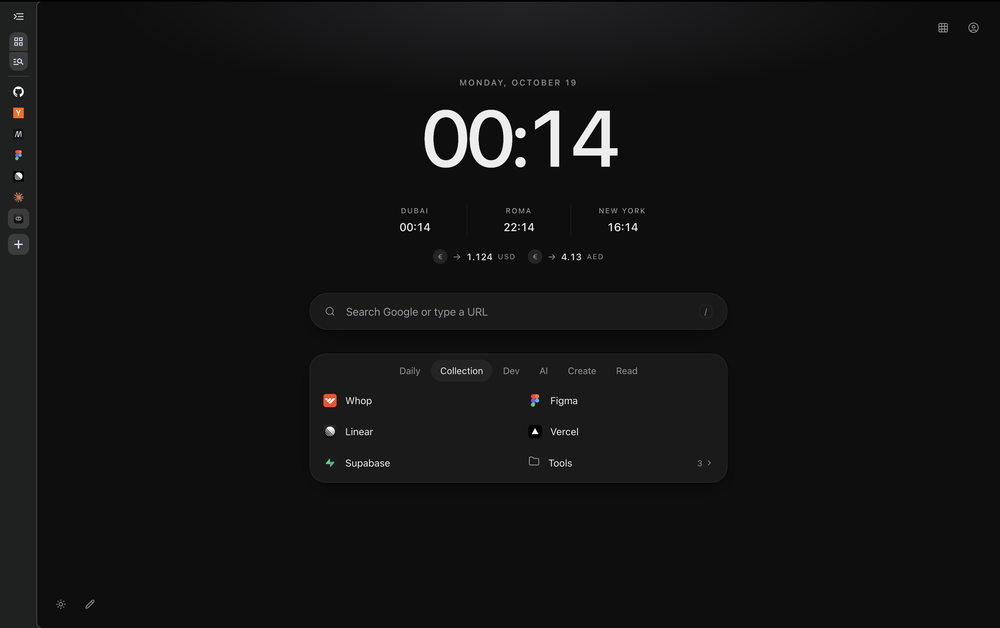
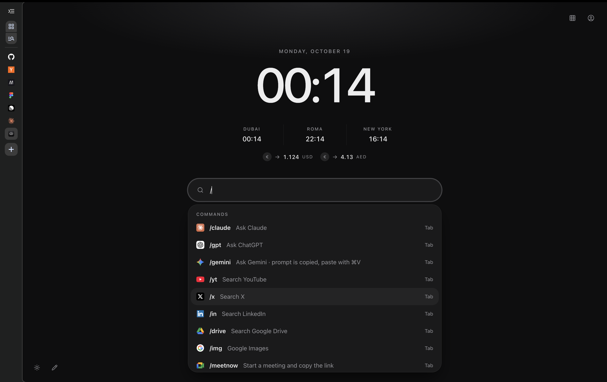

# Atrium

**A `/` command center for your browser.**

A new way to use your browser. Organize links, run commands, weigh almost nothing.

 

[Highlights](#highlights) · [Install](#install) · [Commands](#commands) · [Privacy](#privacy) · [Roadmap](#roadmap)

 

## Highlights

- **Slash commands.** Ask Claude or ChatGPT, search YouTube or X, start a Google Meet, jump to an open tab or find a local dev server.
- **One search bar.** Google suggestions, open tabs, your links and your history in one list.
- **Tidy links.** Tabs, folders, inline editing and drag and drop.
- **Time at a glance.** A large clock, world times and live exchange rates.
- **Google account switcher.** Pick which account your Google links open in.
- **Built for power users.** Plain HTML, CSS and JavaScript. No frameworks, no tracking.

## Install

1. [Download the latest release](../../releases/latest) and unzip it, or `git clone https://github.com/dpichler-22/atrium.git`.
2. Open `chrome://extensions` and turn on **Developer mode**.
3. Click **Load unpacked**, select the `atrium` folder, and open a new tab.

Tested in Chrome on macOS. It should also work in Edge, Brave and other Chromium browsers.

> [!IMPORTANT]
> The browser runs Atrium from that folder, so keep it somewhere permanent.

## Commands

Type a command, press <kbd>Space</kbd> or <kbd>Tab</kbd>, then your query.

| Command    | What it does                                       |
| ---------- | -------------------------------------------------- |
| `/claude`  | Ask Claude                                         |
| `/gpt`     | Ask ChatGPT                                        |
| `/gemini`  | Ask Gemini                                         |
| `/yt`      | Search YouTube                                     |
| `/x`       | Search X                                           |
| `/in`      | Search LinkedIn                                    |
| `/drive`   | Search Google Drive                                |
| `/img`     | Search Google Images                               |
| `/meetnow` | Start a Google Meet and copy the link, or join one |
| `/tab`     | Switch to an open tab                              |
| `/history` | Search your history                                |
| `/ports`   | Find dev servers running on `localhost`            |

**Shortcuts:** <kbd>/</kbd> focuses search · <kbd>⌘</kbd>/<kbd>Ctrl</kbd> + <kbd>Enter</kbd> opens in a new tab · <kbd>Ctrl</kbd> + <kbd>C</kbd> clears the bar · <kbd>Esc</kbd> closes menus

**Edit your links** with the pencil in the bottom-left corner.

## Privacy

No account, analytics or server. Search queries are never stored, and links stay in your browser profile.

| Connects to                                    | When                                |
| ---------------------------------------------- | ----------------------------------- |
| `suggestqueries.google.com`                    | While you type                      |
| `google.com/s2/favicons`                       | To show website icons               |
| `open.er-api.com`                              | Exchange rates, every 6 hours       |
| `accounts.google.com`, `googleusercontent.com` | Only when you open the account menu |
| `localhost`                                    | Only while `/ports` is open         |

<b>Permissions</b>

| Permission                            | Why                                                                                                                          |
| ------------------------------------- | ---------------------------------------------------------------------------------------------------------------------------- |
| `tabs`                                | `/tab` and `/meetnow`                                                                                                        |
| `history`                             | History results and `/history`                                                                                               |
| `declarativeNetRequestWithHostAccess` | Removes the `Origin` header on requests to `accounts.google.com`, so the account menu works. See [`rules.json`](rules.json). |

<b>Performance</b>

About 0.2 MB of memory above an empty tab, and the same idle CPU. Nothing runs in the background: the only timer is the clock, once a minute.

## Roadmap

- [ ] Personalize commands
- [ ] More commands and features
- [ ] Choose your own world clocks and currencies
- [ ] Import and export links
- [ ] Chrome Web Store release

Have an idea? [Open an issue](../../issues/new/choose). Pull requests are welcome, see [CONTRIBUTING.md](CONTRIBUTING.md).

## License

[MIT](LICENSE) © Davide Pichler

<i>Logos for Claude, ChatGPT, Gemini, YouTube, X, LinkedIn and Google apps are trademarks of their owners. They are included only to identify those services and are not covered by the MIT license.</i>
